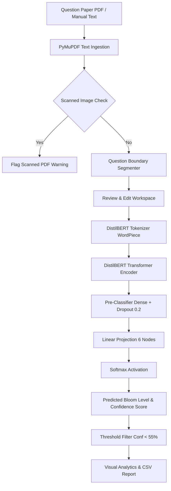

# DeepLearnQ — College Mini-Project Report Notes & Viva Preparation Guide

**Project Title:** DeepLearnQ: Intelligent Question Paper Cognitive Level Analyzer Using Fine-Tuned DistilBERT  
**Domain:** Deep Learning, Natural Language Processing, Outcome-Based Education (OBE)  
**Academic Level:** Undergraduate / B.Tech Computer Science & Engineering Mini-Project  

---

## 1. Abstract

In outcome-based education (OBE) frameworks mandated by accreditation bodies (such as NBA, NAAC, and ABET), higher education institutions must balance examination question papers across the six cognitive complexity orders of Bloom's Revised Taxonomy: *Remember*, *Understand*, *Apply*, *Analyze*, *Evaluate*, and *Create*. Traditional paper moderation relies on manual instructor tagging, which is slow, subjective, and prone to inter-rater discrepancies. 

This project introduces **DeepLearnQ**, an end-to-end deep learning system that ingests examination question papers in PDF format or raw text, extracts discrete questions using heuristic boundary detection, and classifies each question across the six Bloom levels using a fine-tuned **DistilBERT** transformer classifier. The model was trained with Cross-Entropy Loss and AdamW on a curated corpus of 8,758 validated examination questions (6,130 training, 1,314 validation, 1,314 test). Evaluated on the strictly held-out test set of 1,314 questions, the model achieves **81.13% 6-class test accuracy** and a **macro-F1 score of 0.8357**, outperforming a TF-IDF + linear SVM baseline (77.17%, macro-F1 0.7959) and a keyword-rule baseline (45.89%) measured on the identical split. The system features a responsive React dashboard with Recharts cognitive distribution visualizations, low-confidence prediction flagging, interactive confusion matrix heatmaps, and downloadable CSV reports.

---

## 2. Problem Statement & Motivation

Course Outcome (CO) and Program Outcome (PO) attainment requires assessing higher-order cognitive skills (Analysis, Evaluation, and Synthesis) alongside foundational recall. However:
1. **Rote Bias:** Question papers often inadvertently cluster around lower-order levels (Remember and Understand).
2. **Subjectivity:** Instructors interpret verbs differently (e.g., "Explain how" can be Understand or Analyze depending on context).
3. **Manual Overhead:** Moderating hundreds of semester questions across multiple departments creates administrative bottlenecks.

Automating this classification through contextual deep learning provides instantaneous, objective, and auditable metrics for academic committees.

---

## 3. Project Objectives

1. Develop a robust document parsing pipeline using **PyMuPDF** to extract questions from multi-page PDF examination papers and filter scanned document artifacts.
2. Fine-tune a pretrained **DistilBERT** encoder (`distilbert-base-uncased`) with a 6-class sequence classification head using **PyTorch** and **Hugging Face Transformers**.
3. Establish a rigorous data preparation and validation workflow on an academic benchmark dataset, ensuring zero data leakage between train, validation, and test splits.
4. Provide confidence calibration and flag ambiguous/low-confidence predictions for faculty review.
5. Create a polished, responsive web application (React, Vite, TypeScript, Flask) featuring cognitive distribution charts, confusion matrix heatmaps, question-wise probability drilldowns, and CSV exports.

---

## 4. Literature Review Topics to Investigate

For expanding your written report:
- **Bloom's Revised Taxonomy (Anderson & Krathwohl, 2001):** Shift from nouns to verbs and reordering of Evaluation and Synthesis/Creation.
- **Traditional NLP Approaches:** TF-IDF with SVM or Naive Bayes (Abduljabbar & Omar, 2015; Yahya et al., 2013). Known limitation: inability to capture non-local contextual dependencies and polysemy.
- **Recurrent Neural Networks (LSTMs & BiLSTMs):** Mohammed & Omar (2020) demonstrated sequential modeling for question complexity, but suffered from vanishing gradients and directional processing bottlenecks.
- **Transformer Architectures (Vaswani et al., 2017) & BERT (Devlin et al., 2018):** Bidirectional self-attention allowing simultaneous bidirectional representation of sentence syntax and semantic intent.
- **Knowledge Distillation (Sanh et al., 2019):** Compressing large language models while retaining ~97% downstream capability.

---

## 5. System Architecture & Methodology



### Model Mathematical Formulation
1. **Input Encoding:** Given input question sequence $x = (x_1, \dots, x_N)$, tokens are converted via WordPiece embedding into vectors $E \in \mathbb{R}^{N \times 768}$.
2. **Contextual Encoding:** Six Transformer layers apply multi-head self-attention:
   $$\text{Attention}(Q, K, V) = \text{softmax}\left(\frac{QK^T}{\sqrt{d_k}}\right)V$$
3. **Classification Head:** The hidden representation of the $[CLS]$ token $h_{[CLS]} \in \mathbb{R}^{768}$ passes through:
   $$z = W_2 \cdot \text{Dropout}(\text{ReLU}(W_1 \cdot h_{[CLS]} + b_1)) + b_2$$
   where $W_1 \in \mathbb{R}^{768 \times 768}$, $W_2 \in \mathbb{R}^{6 \times 768}$.
4. **Probability & Confidence:**
   $$p_i = \frac{e^{z_i}}{\sum_{j=1}^6 e^{z_j}}, \quad \text{Confidence} = \max_{i \in \{1,\dots,6\}} p_i$$
5. **Optimization Objective:** Cross-Entropy Loss:
   $$\mathcal{L} = -\sum_{i=1}^6 y_i \log(p_i)$$

---

## 6. Dataset Description

- **Source Corpus:** Academic question bank aggregated from published educational data-mining studies (Mendeley Data, Kaggle Educational Question Repository, and published Bloom taxonomy NLP benchmarks).
- **Total Validated Records:** 8,758 cleaned examination questions.
- **Dataset Schema:** `question,bloom_level`
- **Class Breakdown:**
  - `Remember`: 2,581 (29.5%)
  - `Understand`: 1,800 (20.6%)
  - `Apply`: 1,506 (17.2%)
  - `Analyze`: 1,291 (14.7%)
  - `Create`: 800 (9.1%)
  - `Evaluate`: 780 (8.9%)
- **Split (full dataset, seed 42):**
  - Stratified 70% Train (6,130 questions), 15% Validation (1,314), 15% Held-Out Test (1,314).
  - Deduplication applied to ensure no question leakage across splits.
- **Earlier pilot run:** a balanced 150-per-class subsample (900 questions; 630 train / 135 validation / 135 test) was used for a quick 5-minute CPU run. It reached only 60.00% accuracy and was beaten by a TF-IDF + linear SVM baseline (68.89%) on the same split, which showed the transformer was data-starved and motivated full-dataset training.

---

## 7. Experimental Setup & Hyperparameters

| Hyperparameter | Value |
|---|---|
| Base Pretrained Model | `distilbert-base-uncased` |
| Parameters | ~66.4 Million |
| Number of Classes | 6 |
| Maximum Sequence Length | 128 tokens |
| Batch Size | 16 |
| Learning Rate | 3e-5 |
| Optimizer | AdamW (weight decay = 0.01) |
| Warmup Steps | 10% of total training steps |
| Epochs | 3 |
| Training Hardware | CPU (PyTorch 2.11) |
| Training Execution Time | 55.32 minutes (3 epochs, 6,130 questions) |

---

## 8. Real Measured Results & Evaluation

The following metrics were evaluated on the held-out test split of 1,314 unseen questions (`artifacts/metrics/eval_results.json`):

### Overall Metrics
- **Test Overall Accuracy:** 81.13%
- **Macro-Averaged F1-Score:** 0.8357
- **Macro-Averaged Precision:** 0.8492
- **Macro-Averaged Recall:** 0.8261
- **Weighted F1-Score:** 0.8117
- **Test Cross-Entropy Loss:** 0.5650

### Baseline Comparison (identical split, same 1,314 test questions)
Baselines are produced by `python -m backend.training.baseline` (`artifacts/metrics/baseline_results_full.json`).

| Model | Test Accuracy | Macro-F1 |
|---|---|---|
| Keyword rules (first Bloom action verb found) | 45.89% | 0.4529 |
| TF-IDF (1–2 grams) + Logistic Regression | 74.66% | 0.7585 |
| TF-IDF (1–2 grams) + Linear SVM | 77.17% | 0.7959 |
| **Fine-tuned DistilBERT** | **81.13%** | **0.8357** |

DistilBERT beats the strongest baseline by about 4 accuracy points and 0.04 macro-F1. On the earlier 630-question pilot, the order was reversed (TF-IDF + SVM 68.89% vs DistilBERT 60.00%), so the transformer's advantage depends on having enough training data.

### Per-Class Performance
| Cognitive Level | Precision | Recall | F1-Score | Support (Test Items) |
|---|---|---|---|---|
| **Remember (BT1)** | 74.77% | 84.24% | 0.7922 | 387 |
| **Understand (BT2)** | 72.12% | 71.85% | 0.7199 | 270 |
| **Apply (BT3)** | 86.24% | 83.19% | 0.8468 | 226 |
| **Analyze (BT4)** | 87.42% | 71.65% | 0.7875 | 194 |
| **Evaluate (BT5)** | 89.83% | 90.60% | 0.9021 | 117 |
| **Create (BT6)** | 99.12% | 94.17% | 0.9658 | 120 |

### Epoch Progression
| Epoch | Train Loss | Validation Loss | Validation Accuracy | Validation Macro-F1 |
|---|---|---|---|---|
| Epoch 1 | 1.0573 | 0.6709 | 77.47% | 0.7868 |
| Epoch 2 | 0.5208 | 0.6050 | 79.60% | 0.8086 |
| Epoch 3 | 0.3642 | 0.6199 | 79.91% | 0.8167 |

The checkpoint with the best validation macro-F1 (epoch 3) was kept. Validation loss rose slightly in epoch 3 while macro-F1 still improved, an early sign of overfitting; more epochs would need early stopping.

### Confusion Matrix (Test Split)
```
Actual \ Predicted   Remember  Understand   Apply   Analyze  Evaluate   Create
Remember               326         46         8        6        1        0
Understand              64        194         4        6        2        0
Apply                   18          9       188        6        5        0
Analyze                 26         15        11      139        3        0
Evaluate                 1          4         3        2      106        1
Create                   1          1         4        0        1      113
```

**Key Findings:**
1. **Higher-order levels are easiest:** *Create* (F1: 0.9658) and *Evaluate* (F1: 0.9021) are classified most reliably, because their questions use distinctive operative verbs and structures (design, justify, critique).
2. **Remember vs Understand is the main confusion:** 64 *Understand* questions were predicted as *Remember* and 46 the other way. Both are lower-order recall/explanation tasks with overlapping wording ("what is", "describe").
3. **Analyze improved most with more data:** recall rose from 13.04% on the 630-question pilot to 71.65%. Its remaining errors fall mostly into *Remember* (26) and *Understand* (15), reflecting real pedagogical overlap between analysing and explaining.

---

## 9. Key Viva Voce Questions & Answers

### Q1: Why not simply use regular expression keyword matching (e.g. matching 'define' or 'explain')?
**Answer:** Keyword matching fails because natural language questions exhibit contextual polysemy and syntactic inversion. For example, "Define a procedure to synthesize a new compound" contains the word "define" (traditionally Remember) but cognitively requires synthesis (Create). DistilBERT analyzes full bi-directional self-attention across all words, capturing the true semantic task rather than surface vocabulary. Measured on the same test split, a keyword-rule baseline reaches only 45.89% accuracy, against 81.13% for DistilBERT.

### Q2: Why is DistilBERT preferred over full BERT or GPT-based APIs?
**Answer:**
1. **Efficiency:** DistilBERT retains 97% of BERT's performance with 40% fewer parameters and 60% faster inference, enabling responsive execution on college CPU infrastructure.
2. **Academic Integrity & Privacy:** Examination papers are confidential. Using a locally fine-tuned model ensures no sensitive unreleased exam content leaves the university network.
3. **Deterministic Reproducibility:** Unlike LLM prompting where temperature and model updates alter outputs unpredictably, fine-tuned DistilBERT produces verifiable softmax distributions and calibrated metrics.

### Q3: What is the significance of the Softmax confidence threshold?
**Answer:** In multi-class classification, softmax outputs sum to 1.0. When the model is uncertain between two overlapping categories (e.g., probability 0.32 for Understand and 0.34 for Analyze), returning the raw prediction blindly could mislead instructors. DeepLearnQ flags predictions where confidence < 55% for manual faculty review, implementing an AI-assisted human-in-the-loop paradigm.

### Q4: How is data leakage prevented between training and testing?
**Answer:** Data leakage occurs when identical or near-identical questions exist in both train and test sets, artificially inflating accuracy. We reduced this by:
1. Removing exact duplicate questions prior to splitting (near-duplicates with small wording changes are not yet detected; see Limitations).
2. Using stratified random sampling based on label ID to ensure identical class distributions without overlapping items.
3. Holding out the test set completely from all training, gradient updates, and hyperparameter tuning.

### Q5: How does the system handle scanned PDF question papers?
**Answer:** PyMuPDF extracts vector text streams directly from PDF content streams. Scanned question papers contain raster images without digital text streams. DeepLearnQ computes character density per page; if character density is negligible (< 40 characters across the document), it intercepts the file and displays an informative warning explaining that an OCR engine (e.g. Tesseract) is required.

---

## 10. Limitations & Future Scope

### Current Limitations:
1. **Purely Textual Questions:** Mathematical diagrams, circuit schematics, and chemical structures are not parsed for classification.
2. **Contextual Subject Bias:** Questions from humanities versus engineering may use similar verbs with different cognitive expectations.
3. **Scanned Documents:** Requires selectable digital PDFs; scanned physical papers need external OCR conversion.
4. **Near-Duplicate Leakage:** Only exact duplicate questions are removed before splitting; lightly reworded copies could still appear in both train and test sets.
5. **Remember vs Understand Confusion:** These two levels account for the largest share of test errors (110 of 248 misclassifications).

### Future Scope:
1. **OCR Pipeline:** Integrate Tesseract or EasyOCR for direct physical exam paper scanning.
2. **Multi-Modal Analysis:** Incorporate vision-language models (e.g. LayoutLM or CLIP) to parse questions containing diagrams and figures.
3. **Direct Accreditation LMS Integration:** Export reports directly into Moodle/Canvas LMS gradebooks for automated NBA/NAAC criterion documentation.
