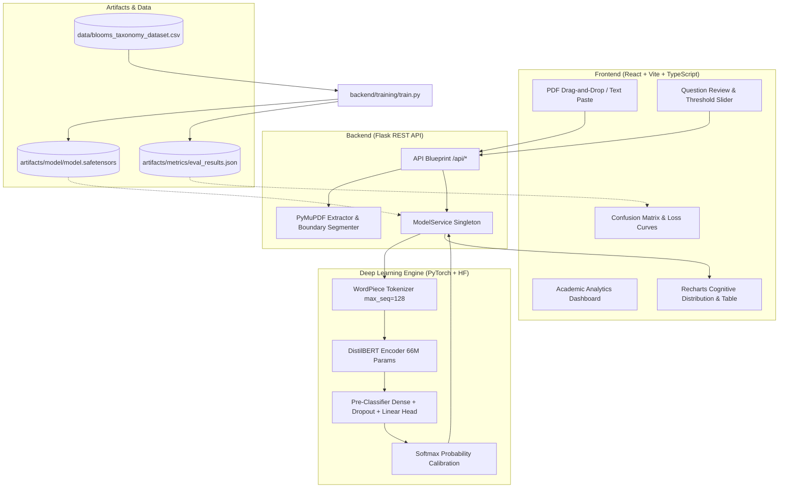

# DeepLearnQ — Intelligent Question Paper Analyzer

[](https://python.org)
[](https://pytorch.org)
[](https://huggingface.co/distilbert-base-uncased)
[](https://react.dev)
[](https://vitejs.dev)
[](tests/test_backend.py)

**DeepLearnQ** is an end-to-end Deep Learning examination question paper cognitive analyzer. It ingests semester examination question papers in PDF format or raw text, segments the individual questions, and classifies each question across the **six cognitive levels of Bloom's Revised Taxonomy** using a fine-tuned **DistilBERT** transformer neural network.

The system helps universities, departments, and course instructors verify cognitive balance (Outcome-Based Education / NBA / NAAC compliance), flag lower-order recall biases, identify ambiguous low-confidence questions, and export auditable CSV reports.

---

## 1. System Architecture



---

## 2. Key Features

1. **PDF Question Paper Extraction:** 
   - Accepts PDF documents up to 15MB.
   - Streams text page-by-page using `PyMuPDF`.
   - Identifies question boundaries (`Q1.`, `1.`, `(a)`, marks indicators).
   - Detects scanned document images with helpful human-in-the-loop warnings.
2. **Manual Question Entry:**
   - Alternative mode to paste multi-line question banks directly without a PDF.
3. **Editable Review Workspace:**
   - Review and modify extracted questions, add new ones, or delete irrelevant snippets before classification.
4. **Fine-Tuned DistilBERT Multi-Class Classifier:**
   - 6 output classes matching Bloom's Revised Taxonomy:
     1. **Remember** (Recall definitions, facts, formulas)
     2. **Understand** (Explain principles, summarize, interpret)
     3. **Apply** (Solve, compute, execute procedures)
     4. **Analyze** (Differentiate, dissect, compare)
     5. **Evaluate** (Critique, appraise, defend decisions)
     6. **Create** (Design, formulate, build novel systems)
5. **Confidence & Ambiguity Flagging:**
   - Computes softmax confidence score for every prediction.
   - Questions below configurable threshold (default < 55%) are flagged for faculty review.
   - Popover to inspect all 6 class probabilities per question.
6. **Visual Analytics & CSV Export:**
   - Recharts distribution bar charts and pie charts.
   - Higher-Order Thinking (HOT) vs Lower-Order Thinking (LOT) ratio.
   - Filterable, searchable, sortable question table.
   - Instant downloadable CSV analysis report.
7. **Model Evaluation Dashboard:**
   - Interactive 6x6 Confusion Matrix heatmap with percentages.
   - Training & Validation Loss curves.
   - Per-class Precision, Recall, and F1-Scores measured on held-out test data.

---

## 3. Technology Stack

### Backend
- **Python 3.11**
- **PyTorch 2.11** (CPU & CUDA compatible)
- **Hugging Face Transformers 5.19** (`distilbert-base-uncased`)
- **PyMuPDF (`fitz`)** (High-fidelity vector PDF extraction)
- **Scikit-Learn** (Stratified train/test splitting & multi-class metrics)
- **Flask & Flask-CORS** (REST API)
- **Pandas & NumPy** (Data processing)
- **pytest** (Automated backend testing)

### Frontend
- **React 19**
- **Vite 6**
- **TypeScript 5.9**
- **Recharts 2.15** (Responsive charts)
- **Lucide-React** (Icons)
- **Custom Design System** (Indigo/Slate light academic dashboard, accessible contrast)

---

## 4. Project Directory Structure

```
deeplearnq/
├── backend/
│   ├── app.py                      # Flask application factory and API server
│   ├── config.py                   # Central hyperparameters, paths, and Bloom metadata
│   ├── requirements.txt            # Python dependencies
│   ├── routes/
│   │   ├── __init__.py
│   │   └── api.py                  # API endpoints (/health, /analyze, /upload, etc.)
│   ├── services/
│   │   ├── __init__.py
│   │   ├── model_service.py        # Singleton inference service (loads model once)
│   │   └── pdf_extractor.py        # PyMuPDF parser and question boundary detector
│   └── training/
│       ├── __init__.py
│       ├── dataset.py              # Data cleansing, validation, and PyTorch DataLoaders
│       ├── train.py                # DistilBERT fine-tuning script with early checkpointing
│       └── evaluate.py             # Evaluation script for held-out test metrics
├── data/
│   ├── README.md                   # Dataset documentation & curation guidelines
│   ├── blooms_taxonomy_dataset.csv # Curated benchmark dataset (8,758 validated questions)
│   ├── dataset_template.csv        # Blank CSV template for user question banks
│   └── sample_exam_paper.pdf       # Test PDF examination paper for instant demonstration
├── artifacts/
│   ├── README.md
│   ├── model/                      # Saved fine-tuned DistilBERT weights & tokenizer
│   └── metrics/
│       ├── eval_results.json       # Measured test accuracy, F1, and confusion matrix
│       └── loss_history.json       # Epoch-wise training & validation loss history
├── frontend/
│   ├── package.json
│   ├── vite.config.ts
│   ├── tsconfig.app.json
│   ├── index.html
│   └── src/
│       ├── App.tsx                 # Main application controller
│       ├── index.css               # Global design tokens and styling
│       ├── types/index.ts          # TypeScript interfaces
│       ├── services/api.ts         # Frontend API client
│       ├── components/
│       │   ├── Navbar.tsx          # Sticky navigation with model readiness pill
│       │   └── Footer.tsx          # Project footer
│       └── pages/
│           ├── Dashboard.tsx       # System overview, quick start, Bloom's guide
│           ├── AnalyzePage.tsx     # PDF drag-and-drop & review table
│           ├── ResultsPage.tsx     # Analytics, charts, question table, CSV download
│           ├── EvaluationPage.tsx  # Test metrics, loss curves, confusion matrix
│           └── AboutPage.tsx       # Mini-project report notes & viva voce Q&A
├── tests/
│   └── test_backend.py             # 14 comprehensive automated unit and API tests
├── .gitignore
├── PROJECT_REPORT_NOTES.md         # Comprehensive report notes & viva guide
└── README.md                       # Master documentation
```

---

## 5. Getting Started & Local Installation

### Prerequisites
- Python 3.10+ (Python 3.11 recommended)
- Node.js 18+ and npm

### Step 1: Install Python Dependencies
```bash
pip install -r backend/requirements.txt
```

### Step 2: Install Frontend Dependencies
```bash
cd frontend
npm install
cd ..
```

---

## 6. How to Run the Application

You need two terminal windows: one for the Flask backend, and one for the React frontend.

### Terminal 1: Start the Backend Server
```bash
python backend/app.py
```
*Backend runs on `http://127.0.0.1:5000`.*

### Terminal 2: Start the Frontend Application
```bash
cd frontend
npm run dev
```
*Frontend opens on `http://localhost:5173` (or the port indicated by Vite).*

Open your browser and navigate to `http://localhost:5173`.

---

## 7. Model Training & Evaluation Pipeline

The project includes pre-trained weights in `artifacts/model/` and real evaluation results in `artifacts/metrics/eval_results.json`. You do **not** need to retrain the model to run the application.

However, if you wish to run fine-tuning yourself:

### Full Dataset Training (8,758 Questions, ~55 minutes on CPU)
This is how the shipped model was trained.
```bash
python -m backend.training.train --epochs 3 --batch_size 16
```

### Quick CPU Pilot (Balanced 900 Question Sample, ~5 minutes)
Useful for checking the pipeline end to end. Too little data for good accuracy (60.00% on its 135-question test split).
```bash
python -m backend.training.train --epochs 3 --batch_size 16 --max_samples_per_class 150
```

### Baselines (Keyword Rules and TF-IDF, seconds)
Trains keyword-rule, TF-IDF + Logistic Regression and TF-IDF + Linear SVM baselines on the identical split.
```bash
python -m backend.training.baseline
```

### Run Evaluation on Held-Out Test Set
```bash
python -m backend.training.evaluate
```

---

## 8. Running Automated Tests

A comprehensive test suite of 14 unit and integration tests is included in `tests/test_backend.py`.

Run tests with:
```bash
python -m pytest tests/test_backend.py -v
```

All 14 tests verify:
- API `/api/health` status and system info
- `/api/model-info` metadata and 6 Bloom levels
- `/api/dataset-info` sample verification
- PDF text extraction & boundary detection
- Scanned PDF detection warning
- Invalid file format rejection
- Empty question list rejection
- Label normalization and dataset split integrity
- Multi-class metric calculation logic
- Real model inference prediction structure
- Evaluation endpoint integrity
- CSV export formatting

---

## 9. API Reference

| Endpoint | Method | Description |
|---|---|---|
| `/api/health` | `GET` | System health, model readiness, device, PyTorch version |
| `/api/model-info` | `GET` | Model architecture, 6 Bloom classes, keywords, color codes |
| `/api/dataset-info` | `GET` | Dataset total rows, class distribution, schema |
| `/api/upload` | `POST` | Ingests PDF file, returns extracted and numbered questions |
| `/api/parse-text` | `POST` | Ingests pasted text, segments questions |
| `/api/analyze` | `POST` | Classifies list of questions into Bloom levels with confidence |
| `/api/evaluation` | `GET` | Returns measured test accuracy, F1, confusion matrix, and loss history |
| `/api/download-results` | `POST` | Generates downloadable CSV report of analysis results |

---

## 10. Sample Examination Demonstration

For demonstration to faculty or evaluators:
1. Start both servers (`python backend/app.py` and `npm run dev`).
2. Go to the **Analyze Paper** tab.
3. Click **Browse** or drag `data/sample_exam_paper.pdf` (or click *Load 6 Illustrative College Questions*).
4. Click **Extract Questions from PDF** to inspect the questions in the review table.
5. Click **Classify Question Paper** to trigger real DistilBERT multi-class inference.
6. Explore the **Results** dashboard: view the cognitive distribution bar chart, pie breakdown, question table, and click **View** to inspect the 6-class softmax probabilities.
7. Click **Download CSV Report** to verify CSV export.
8. Navigate to **Model Evaluation** to showcase the 6x6 confusion matrix and loss curves.

---

## 11. Academic Integrity Statement

- **Real Deep Learning:** Predictions are computed via actual forward passes through fine-tuned DistilBERT weights, not mocked or rule-based heuristics.
- **Genuine Metrics:** All evaluation figures (81.13% accuracy, 0.8357 macro-F1) reflect actual measurements on a strictly held-out test split of 1,314 unseen questions. On the same split, the best baseline (TF-IDF + Linear SVM) reaches 77.17% accuracy and 0.7959 macro-F1.
- **Offline & Private:** Operates entirely locally without sending exam papers to paid third-party generative AI APIs.
